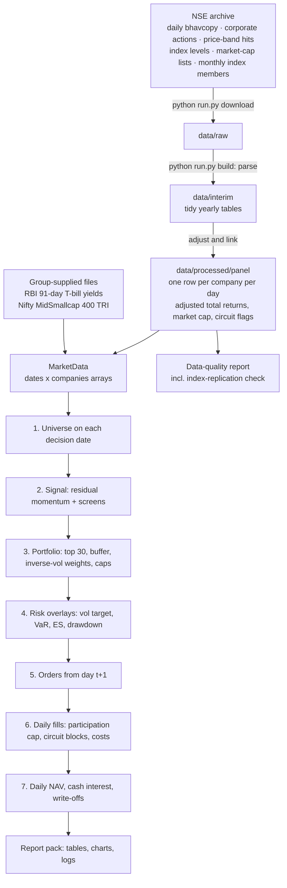
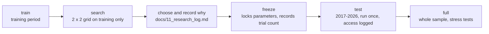

# Slow Diffusion Residual Momentum
### A momentum strategy for Indian mid- and small-cap stocks, with a point-in-time back-testing model built on NSE exchange data

Term Project 1, MBA elective *Algorithmic Trading Strategies*. The brief is in [`Term_Project_Algorithmic_Trading_Strategies.pdf`](Term_Project_Algorithmic_Trading_Strategies.pdf).

<!-- Group members: add both names here and under `authors` in config/strategy.yaml -->

| | |
|---|---|
| **The strategy** | Long-only **residual momentum** in NSE mid and small caps (ranks 101–500), for a closely held ₹50 crore fund whose objective is a consistent return generator |
| **The idea** | News about thinly followed Indian mid and small caps reaches prices slowly, so a stock's **firm-specific** drift over the past 6–12 months tends to continue |
| **The model** | A back-testing engine that rebuilds the market as it was known on each day from 2010 to 2026 and trades the strategy under Indian costs, liquidity limits and price-band locks |
| **Strategy files** | [`config/strategy.yaml`](config/strategy.yaml) (every parameter) · [`docs/03_design_decisions.md`](docs/03_design_decisions.md) (every decision and its reason) |
| **Who did what** | The strategy, the data supplied, the runs, the results and the analysis are the group's; the software was built with Claude Code. See [Who did what](#who-did-what-group-and-ai) |

**Contents:** [1. The strategy](#1-the-strategy) · [2. How the model works](#2-how-the-model-works-the-flow) · [3. Who did what](#who-did-what-group-and-ai) · [4. Data](#4-the-data) · [5. How to run it](#5-how-to-run-it) · [6. Repository map](#6-repository-map) · [7. Limitations](#7-limitations)

---

## 1. The strategy

Full reasoning, with sources, for each decision D1–D14: [`docs/03_design_decisions.md`](docs/03_design_decisions.md). Every value below is in [`config/strategy.yaml`](config/strategy.yaml).

### 1.1 Economic rationale
**Slow information diffusion** (Hong, Lim & Stein 2000). Indian mid and small caps get little analyst and retail attention, so firm-specific news is absorbed into their prices over months rather than days. A stock's return net of the market's moves (its *residual*) therefore keeps drifting in the same direction for a while. The strategy buys the stocks with the strongest, steadiest residual drift.

### 1.2 The strategy at each step

| Step | Rule | Setting |
|---|---|---|
| **Fund** | Closely held fund, long-only, no leverage | ₹50 crore; idle cash earns the 91-day T-bill rate |
| **Universe** | Ranks 101–500 by size, the same ranks as the Nifty MidSmallcap 400. Size = market cap from April 2019; traded value before that (the archive has no earlier market cap); top 100 fixed by the Nifty 50 / Next 50 member lists | about 170–195 stocks eligible in 2012–13, about 350 later |
| **Filters** | Listed 2+ years · price ≥ ₹20 · traded on ≥ 90% of days · median daily traded value ≥ ₹1.1 crore over 6 months · not locked at a price band on > 10% of the last 60 days · EQ series only | the ₹1.1 crore floor is derived: a ₹1.67 crore position must fill within 15 days at 10% of daily volume |
| **Signal** | Market-residual momentum over two windows, months 12→2 and 7→2 before the decision (the latest month is skipped), equally weighted | betas from a 24-month regression |
| **Screens** | The stock's **own** return over months 12→2 must be positive, and its rise must be steady: up on at least as many days as down (information discreteness ≤ 0) | |
| **Portfolio** | The top **30** stocks; a holding is kept until it falls below rank 45 (buffer 1.5) | |
| **Weights** | Inverse volatility (6 months), at most 6% per stock, no sector limit; 1% cash buffer | |
| **Rebalancing** | Monthly review; a position within 0.5 percentage points of its target is left alone | |
| **Execution** | Decide at the close on day *t*, trade from day *t+1* at the day's VWAP, at most 10% of 20-day average traded value **and** of that day's volume; buys worked for up to 15 days; no buying at an upper circuit or selling at a lower circuit | |
| **Costs** | Statutory charges by date (STT, stamp duty, exchange, SEBI, GST) · brokerage 10 bps per side · bid–ask spread estimated from daily prices (Abdi–Ranaldo) · square-root market impact, k = 1.0 | |
| **Risk** | Exposure = 99% × the **smallest** of: volatility target (16.78% a year, floor 50%), 99% 1-day VaR limit 4.5%, 97.5% ES limit 6%, and drawdown tier (−15% → 50%, −25% → 25% for 42 days) | holdings that stop trading for 42 days are written off at −30% |
| **Benchmarks** | Nifty MidSmallcap 400 **TRI**; the equal-weight eligible universe | |
| **Sample** | Training Feb 2012 – Dec 2016 (58 decisions); untouched test Jan 2017 – Oct 2026 (117 decisions) | |
| **Research** | Only 2 × 2 settings compared on training data: 30 vs 40 stocks × monthly vs quarterly review, by net Sharpe | every run is counted |
| **Stress tests** | All small-cap falls of 25% or more in the data (2013, 2015–16, 2018–20, 2022, 2024–25), the Covid crash and rebound; instant shocks of −10/−20/−30%; volume cuts of 50/75%; spreads ×2 and ×3 | |

### 1.3 The signal, precisely
For every eligible stock *i* on decision date *t*:

1. **Market model.** Regress the stock's daily total returns on the market return over the 24 months (504 trading days) ending on *t*:
   *r<sub>i,d</sub> = α<sub>i</sub> + β<sub>i</sub> · m<sub>d</sub> + ε<sub>i,d</sub>*
2. **Residual momentum in each window**, a t-statistic of the firm-specific drift:
   *score<sub>i</sub>(window) = Σ ε<sub>i,d</sub> ÷ ( sd(ε<sub>i,d</sub>) × √n )* over the window's *n* days. The windows are months 12→2 and 7→2 before *t*.
3. **Standardise.** Clip each window's score at the 1st/99th percentile across the eligible stocks, convert to a z-score, and average the two z-scores with equal weight.
4. **Screens.** Drop stocks whose own total return over months 12→2 is not positive. Drop stocks that fell on more days than they rose in that window (Da, Gurun & Warachka 2014).
5. **Select.** Keep current holdings that still rank in the top 45. Fill the remaining places up to 30 from the top of the ranking.

### 1.4 Where each choice comes from
| Choice | Basis |
|---|---|
| Residual instead of raw momentum | Blitz, Huij & Martens (2011): firm-specific momentum, less exposed to market reversals |
| Two windows (12-month and 6-month) | NSE's momentum indices combine 6- and 12-month returns |
| Skipping the latest month | Short-term reversal (Jegadeesh 1990) |
| Positive own return | Absolute momentum (Moskowitz, Ooi & Pedersen 2012); relative + absolute strength in India (Sehgal, Pandey & Sen 2024) |
| Steady-rise filter | "Frog in the pan" (Da, Gurun & Warachka 2014) |
| Sell buffer | Banding cuts momentum turnover (Novy-Marx & Velikov) |
| Volatility targeting; drawdown tiers that never go to zero | Barroso & Santa-Clara (2015), Moreira & Muir (2017); momentum crashes in rebounds (Daniel & Moskowitz 2016) |
| Liquidity floor and 15-day fills | Derived from fund size and the brief's 10% participation limit |
| Stress windows | Dated from the group's own data (`python run.py episodes`) |

---

## 2. How the model works (the flow)

### 2.1 From raw exchange files to a report



### 2.2 Building the data (`python run.py build`)
1. **Parse** every daily exchange file into yearly tables. The parsers handle every file layout and naming variant NSE has used since 2010 (`src/momo/data/parsers.py`, `ingest.py`).
2. **Give each company one identity** across symbol changes and ISIN changes. A symbol later re-used by another company is kept as a separate company (`identifiers.py`).
3. **Adjust returns for corporate actions** (`panel.py`, `corporate_actions.py`). The exchange does **not** adjust its previous-close price on ex-dates, so splits, bonuses, rights and dividends are taken from:
   - the exchange's corporate-action texts (parsed from its 25-character shorthand);
   - the daily share counts;
   - ISIN changes.

   Every adjustment is written to an audit log.
4. **Attach market cap** as known on each day: the daily file from 2024, and the exchange's market-cap lists carried forward with the price before that (`size.py`).
5. **Check the result.** The quality report rebuilds the Nifty 50 and Nifty Next 50 from their published members using these adjusted returns. They track the official indices with correlation 0.9997 and 0.9992 (2012–2026).

### 2.3 The back-test, day by day (`src/momo/backtest.py`)
On every trading day:
1. **Mark to market** the holdings at the day's close; cash earns the day's T-bill rate.
2. **Work open orders.** Fill at the day's VWAP, up to 10% of the stock's 20-day average traded value and 10% of the day's actual volume. Skip stocks locked at a price band. Charge every cost on every fill. Unfilled buys lapse after 15 days; sells never lapse.
3. **Check the drawdown tiers.** If the fund has fallen far enough below its high-water mark, sell down to the lower exposure at once.
4. **Write off** any holding that has not traded for 42 days, at −30%.
5. **On a month-end decision date:**
   - rebuild the universe;
   - compute the signal;
   - choose the 30 names;
   - size them;
   - apply the risk overlays (the smallest limit wins);
   - place orders, which start on the **next** day.

Nothing on day *t* uses data from after *t*. A test deletes all data after a date, re-runs the model and requires an identical history up to that date (`tests/test_backtest.py`).

Each run is simulated three ways, to show what each layer of realism costs:

| Run | Includes |
|---|---|
| **paper** | no costs, no trading limits |
| **gross** | liquidity caps, price-band blocks and order lapses; no costs |
| **net** | everything: the result to report |

### 2.4 The research workflow (out-of-sample discipline)



Every training run is recorded in `results/research/trials.csv`. `freeze` writes `config/frozen_strategy.yaml` and records how many parameter sets were tried. Every opening of the test period is logged in `test_access_log.csv`, together with whether the configuration matched the frozen one.

### 2.5 What each run produces (`results/<period>/`)
About 40 tables and 15 charts:
- performance (net, gross and paper) and against the benchmarks;
- returns by year and by market regime;
- turnover and costs by component;
- signals and orders blocked by each filter and limit;
- attribution by stock, year and size segment;
- factor exposures, VaR back-test, limit breaches and risk events;
- concentration and liquidity profile;
- stress windows, market shocks, liquidity stress and capacity across fund sizes.

The full logs of every order, fill, position and day are also saved.

---

## Who did what: group and AI

The course allows AI to write and debug code, find and summarise papers and design charts, with disclosure. It does not allow AI-generated analysis, results or recommendations to be submitted as the group's own, and it requires each group to design its own strategy. The full declaration is [`docs/07_ai_use_declaration.md`](docs/07_ai_use_declaration.md).

### Done by the group
- **Chose the strategy and every parameter** ([`config/strategy.yaml`](config/strategy.yaml)) and wrote the reasons ([`docs/03_design_decisions.md`](docs/03_design_decisions.md)). This followed a structured review in which Claude explained options, evidence and trade-offs and the group decided. One value, the holdings count (30), was suggested by Claude and adopted; this is marked in both files. An earlier design ("Smooth Mid-Small Momentum") was tried and replaced; its runs stay in the trial count.
- **Collected the data.** Downloaded the NSE archive (2010–2026, about 2.5 GB) and built the dataset on the group's own machine. Supplied the RBI 91-day T-bill auction table and the Nifty MidSmallcap 400 total-return index from niftyindices.com; the original downloads are in `data/external/source/`.
- **Assembled the literature configurations**: 32 published strategies in `docs/literature_configs/`.
- **Ran the model**: training runs and the parameter search; freeze and the test period.
- **The results, their interpretation, the risk policy, the report, the recommendation and the presentation.**
- **Verified** the data, results and citations (`docs/10_verification_checklist.md`).

### Done with Claude Code (AI assistant)
- **All software:** the `src/momo` package, command-line tool, notebook and automated tests, including the synthetic test data used only to test the code.
- **Real-data engineering:** fitting the parsers and the corporate-action logic to what the real NSE files contain; the market-cap sources for 2019–2024; index-rename linking; the index-replication check.
- **Conversion scripts** for the group's downloads (`tools/rbi_tbill_to_csv.py`, `tools/niftyindices_tri_to_csv.py`). Values are not changed.
- **Documentation and templates:** data guide, methodology, code walkthrough, design-options menu, checklists, risk-policy and report skeletons, research-log template.
- **Literature digest** with verification status (`docs/02_literature_review.md`), and checks of citations' bibliographic records.
- **The walkthrough website's plumbing:** checking the site's figures against the data, the script that fills in its results from the frozen test run, and the publishing workflow (`docs/12_site.md`). The site itself is declared in the AI-use appendix.
- **Explanations and checks** during the group's design review: options and evidence for each decision; data facts (coverage, liquidity, size-measure agreement); checks that each draft configuration does what its comments say, which led to corrections (signal-window convention, the positive-momentum screen for residual signals).

Two safeguards are built into the code:
- the model refuses to run while any design field is blank;
- outputs from the synthetic test data or the example configuration are stamped so they cannot be mistaken for results.

---

## 4. The data

| Data | Source | Coverage |
|---|---|---|
| Daily prices, volumes, ISINs | NSE cash-market bhavcopy (`nsearchives.nseindia.com`) | Jan 2010 – Nov 2026 |
| Corporate actions, price-band hits | NSE daily "PR" archive | 2010 – 2026 |
| Market capitalisation | NSE daily file (2024+); NSE "market capitalisation – all companies" lists (Mar 2019 – Mar 2024) | none before 2019 |
| Nifty 50 / Next 50 members and weights | NSE monthly index files | 2008 – 2026 |
| Index levels (price) | NSE all-index closing snapshot | Feb 2012 – 2026 |
| Risk-free rate | RBI, *Auctions of 91-Day Government of India Treasury Bills* (supplied by the group) | 1993 – 2026 |
| Benchmark (total return) | niftyindices.com, Nifty MidSmallcap 400 TRI (supplied by the group) | 2010 – 2026 |

**The built dataset:**
- **Size:** 4,186 trading days, 3,267 companies and about 6.9 million company-days.
- **No survivorship bias:** it includes the 625 companies that stopped trading.
- **Known gaps:** what the archive lacks (market cap before 2019, index levels before 2012, sector labels for most companies) is documented in [`docs/01_data_requirements.md`](docs/01_data_requirements.md).

Raw and processed data are not stored in the repository (git-ignored); `download` and `build` recreate them.

---

## 5. How to run it

The commands below assume Python 3.10 or later.

**Install and test:**
```bash
pip install -r requirements.txt
```
```bash
python -m pytest
```

**Get and build the data** (on an Indian network; about 1.5 hours and 2.5 GB):
```bash
python run.py download
```
```bash
python run.py build
```

**Look at the facts:**
```bash
python run.py sizecheck
```
```bash
python run.py liquidity
```
```bash
python run.py episodes --index "NIFTY SMALLCAP 100"
```

**Check, train, compare** (training period only):
```bash
python run.py check
```
```bash
python run.py train --note "base case"
```
```bash
python run.py search --note "holdings x rebalance"
```

**Freeze, test once, run the full sample:**
```bash
python run.py freeze
```
```bash
python run.py test --strategy config/frozen_strategy.yaml
```
```bash
python run.py full --strategy config/frozen_strategy.yaml
```

**Fill in the website's results** (after the test run; see [`docs/12_site.md`](docs/12_site.md)):
```bash
python site/build_site_data.py
```

To try the model without real data, `python run.py fixture` builds a synthetic test market; everything it produces is stamped SYNTHETIC. The notebook `notebooks/momentum_end_to_end.ipynb` runs the same steps with every intermediate result visible.

---

## 6. Repository map

```
config/
  strategy.yaml               THE GROUP'S STRATEGY - every parameter
  data.yaml                   where data lives, what to download
  statutory_charges.yaml      dated Indian charges, each with a source
  strategy.template.yaml      blank template the strategy was built from
  examples/smoke_test.yaml    placeholder config for checking the code runs (outputs stamped)
data/
  external/                   group-supplied: risk_free.csv, benchmarks/, source/ (original downloads)
  raw/ interim/ processed/    NSE files and the built dataset (git-ignored)
docs/
  03_design_decisions.md      THE GROUP'S DECISIONS AND REASONS (D1-D14)
  03_design_options.md        the menu behind each decision: options, evidence, data facts
  00_group_checklist.md       the group's to-do list, in order
  01_data_requirements.md     data sources, layouts, and what the real archive contains
  02_literature_review.md     reading guide, with verification status
  literature_configs/         32 published strategies written in the template's layout
  04_methodology.md           how each realism rule is implemented; known limitations
  05_risk_policy_template.md  the written risk policy
  06_report_template.md       the report, exhibit by exhibit
  07_ai_use_declaration.md    the AI-use declaration
  08_code_walkthrough.md      what each code file does
  09_ic_qa_prep.md            questions to prepare for
  10_verification_checklist.md
  11_research_log.md          one row per training run: question, basis, outcome, decision
  12_site.md                  the walkthrough website: sources of its figures, filling in results, publishing
site/                         the walkthrough website (plain HTML/JS; figures only in data.js)
notebooks/momentum_end_to_end.ipynb
src/momo/                     the model (data, universe, signals, portfolio, costs, backtest, risk, stress, analytics, report)
tests/                        automated tests, on synthetic data
tools/                        conversion scripts for the group's downloads; notebook builder
run.py                        command-line entry point
```

---

## 7. Limitations

These are stated in full in the report and in [`docs/03_design_decisions.md`](docs/03_design_decisions.md).
- **Size measure:** before April 2019, "mid" and "small" mean liquidity tiers (traded value), not market-cap tiers.
- **Surveillance:** no ASM/GSM history, so the only surveillance screen is the EQ-series rule.
- **Sectors:** most companies have no sector label, so there is no sector limit.
- **Market series:** the market return in the residual regression changes source in 2012 and 2020.
- **Rebalancing:** positions change only at monthly reviews and drawdown cuts.
- **Training period:** short (58 monthly decisions).
- **Execution:** VWAP fills, spreads estimated from daily prices, and a one-parameter impact model.

## Licence and disclaimer

MIT licence (see `LICENSE`). Course work for teaching purposes; nothing here is investment advice. Back-tested performance does not guarantee future results.
